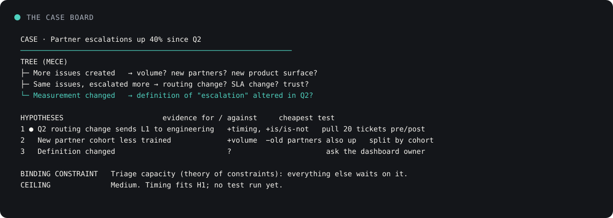

<p align="center"></p>

# Panta Rhei Solve

A problem-solving and root-cause diagnosis skill for Claude, Claude Code and Hermes: issue trees, ranked hypotheses and the cheapest test.

<p align="center">
  <a href="#install"></a>
  
  
  
</p>

## What it does

Asked why something is happening, an AI tends to offer one plausible story. Panta Rhei Solve builds a case board instead: a MECE issue tree, three to five ranked hypotheses with evidence for and against, and the cheapest test that tells the top two apart. You get the likely cause, the binding constraint and an honest statement of how sure the evidence lets you be.

<p align="center"></p>

## Try it

Say any of these after installing:

> Partner escalations are up 40% since Q2. Why?
> Our onboarding conversion dropped last month and nobody knows why
> Why does this team keep missing its sprint goals?

## How it works: The Case Board

The board lays out the tree, the hypotheses and the tests on one screen. It always includes the boring hypothesis (measurement changed, small sample, regression to the mean) and ends with a one-line ceiling on what the evidence supports.

<p align="center"></p>

```
CASE · Partner escalations up 40% since Q2
───────────────────────────────────────────────────────────────
TREE (MECE)                          
├─ More issues created   → volume? new partners? new product surface?
├─ Same issues, escalated more → routing change? SLA change? trust?
└─ Measurement changed   → definition of "escalation" altered in Q2?

HYPOTHESES                       evidence for / against     cheapest test
1 ● Q2 routing change sends L1 to engineering   +timing, +is/is-not   pull 20 tickets pre/post
2   New partner cohort less trained             +volume  −old partners also up   split by cohort
3   Definition changed                          ?                      ask the dashboard owner

BINDING CONSTRAINT   Triage capacity (theory of constraints): everything else waits on it.
CEILING              Medium. Timing fits H1; no test run yet.
```

1. **Pin the problem:** one sentence, plus where it is and is not happening.
2. **Choose the play:** one of nine diagnostic routes, or a sequence built from the catalog.
3. **Build the board:** MECE tree, ranked hypotheses, discriminating tests, binding constraint.
4. **Contrast pair:** the two models that disagree about the cause, and which wins here.

## Install

**Claude Code**
```
/plugin marketplace add fairyanna85/pantarhei-solve
/plugin install pantarhei-solve@pantarhei-solve
```
Or install the whole family: `/plugin marketplace add fairyanna85/pantarhei`.

**Hermes Agent**
```
hermes skills install https://github.com/fairyanna85/pantarhei-solve
```

**Claude apps (web, desktop, mobile)**
1. Download [`pantarhei-solve.zip`](https://github.com/fairyanna85/pantarhei-solve/releases/latest/download/pantarhei-solve.zip).
2. Go to **Customize > Skills**, click **+**, then **+ Create skill**, then **Upload a skill**, and choose the ZIP.
3. Turn the skill on. Code execution and file creation must be enabled (Settings > Capabilities).

**Any Agent Skills client** (Codex, Cursor and others): copy `skills/pantarhei-solve/` into your
client's skills folder.

## What's inside

| Group | Methods |
|---|---|
| **Structure the question** | Issue tree (MECE) · Hypothesis-driven problem solving · Driver tree · Situation, complication, question, answer · Two-by-two · Value chain · Seven elements of an organisation |
| **Find the cause** | Five whys · Fishbone diagram · Is / is not analysis · Differential diagnosis · Inference to the best explanation · Fault tree · Swiss cheese model · Current reality tree |
| **Map the system** | Five focusing steps · Leverage points · Causal loop diagram |
| **Get unstuck** | Understand, plan, carry out, look back · Solve a simpler problem · Work backward · Fermi estimate · Explain it to a duck |
| **Test and improve** | Smallest test · Plan, do, check, act · A3 report · Define, measure, analyse, improve, control |

## How honest is it?

Every method carries an evidence class (`formal`, `empirical`, `heuristic`, `analogical`) and its
origin, and the skill caps its claims by them. Practitioner methods are labelled as such.
Formal methods (issue trees, driver trees, fault trees) are only as good as their inputs; the board says when the cause is underdetermined rather than picking a story.

## The Panta Rhei pack (optional)

Each module works on its own. The pack installs all five plus Panta Rhei, the hub that runs them
end to end.

| | Module | For |
|---|---|---|
| 🔵 | [Panta Rhei Reframe](https://github.com/fairyanna85/pantarhei-reframe) | Working out what the real problem is |
| 🟣 | [Panta Rhei Brainstorm](https://github.com/fairyanna85/pantarhei-brainstorm) | Brainstorming and idea generation |
| 🟢 | [Panta Rhei Solve](https://github.com/fairyanna85/pantarhei-solve) | Structuring and diagnosing problems |
| 🔴 | [Panta Rhei Challenge](https://github.com/fairyanna85/pantarhei-challenge) | Red-teaming ideas and claims |
| 🟡 | [Panta Rhei Decide](https://github.com/fairyanna85/pantarhei-decide) | Making the call |
| ⚫ | [Panta Rhei](https://github.com/fairyanna85/pantarhei) | The pack: all five, end to end |

## Credits and license

Methods are credited to their originators in `catalog.json` and on every card; all descriptions are
our own wording. Code: MIT. Method text: CC BY 4.0. Propose a method: see [CONTRIBUTING.md](CONTRIBUTING.md).
