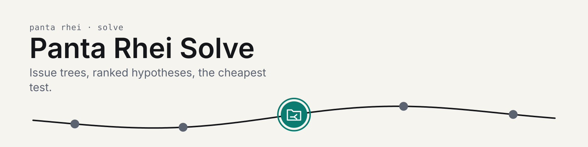
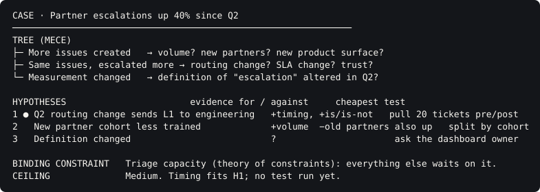

<p align="center"></p>

# Panta Rhei Solve

A problem-solving and root-cause diagnosis skill for Claude, Claude Code and Hermes: issue trees, ranked hypotheses and the cheapest test.

<p align="center">
  <a href="#install"></a>
  
  
  
</p>

## What it does

Asked why something is happening, an AI tends to offer one plausible story. Panta Rhei Solve builds a case board instead: a MECE issue tree, three to five ranked hypotheses with evidence for and against, and the cheapest test that tells the top two apart. You get the likely cause, the binding constraint and an honest statement of how sure the evidence lets you be.

## Try it

Say any of these after installing:

> Partner escalations are up 40% since Q2. Why?
> Our onboarding conversion dropped last month and nobody knows why
> Why does this team keep missing its sprint goals?

## How it works: The Case Board

The board lays out the tree, the hypotheses and the tests on one screen. It always includes the boring hypothesis (measurement changed, small sample, regression to the mean) and ends with a one-line ceiling on what the evidence supports.

<p align="center"></p>

<p align="center"></p>

1. **Pin the problem:** one sentence, plus where it is and is not happening.
2. **Choose the play:** one of nine diagnostic routes, or a sequence built from the catalog.
3. **Build the board:** MECE tree, ranked hypotheses, discriminating tests, binding constraint.
4. **Contrast pair:** the two models that disagree about the cause, and which wins here.

## Install

**Claude Code**
```
/plugin marketplace add fairyanna85/pantarhei-solve
/plugin install pantarhei-solve@pantarhei-solve
```
Or install the whole family: `/plugin marketplace add fairyanna85/pantarhei`.

**Hermes Agent**
```
hermes skills install https://github.com/fairyanna85/pantarhei-solve
```

**Claude apps (web, desktop, mobile)**
1. Download [`pantarhei-solve.zip`](https://github.com/fairyanna85/pantarhei-solve/releases/latest/download/pantarhei-solve.zip).
2. Go to **Customize > Skills**, click **+**, then **+ Create skill**, then **Upload a skill**, and choose the ZIP.
3. Turn the skill on. Code execution and file creation must be enabled (Settings > Capabilities).

**Any Agent Skills client** (Codex, Cursor and others): copy `skills/pantarhei-solve/` into your
client's skills folder.

## What's inside

27 methods of its own, plus 10 shared with sister skills and 70 audit models from the shared library. Every method carries an evidence class and a named failure mode.

### Structure the question

- **Issue tree (MECE)** — Break the question into sub-questions that are mutually exclusive and collectively exhaustive, then repeat down to questions small enough to answer…
- **Hypothesis-driven problem solving** — State the most likely answer early, then design the analysis to prove or kill it.
- **Driver tree** — Decompose a metric into the arithmetic drivers that produce it (revenue = volume × price; volume = traffic × conversion).
- **Situation, complication, question, answer** — State the stable situation, the complication that disturbed it, the question that raises, and the answer.
- **Two-by-two** — Pick the two dimensions that matter most and place the options on them.
- **Value chain** — Lay out the sequence of activities that create value and their costs.
- **Seven elements of an organisation** — Strategy, structure, systems, shared values, style, staff and skills interact.

### Find the cause

- **Five whys** — Ask why the problem occurred, then why that cause occurred, around five times, until the answer is a process you can change rather than a person to…
- **Fishbone diagram** — Lay out candidate causes by category (people, process, materials, equipment, environment, measurement) before choosing one.
- **Is / is not analysis** — Specify where, when and to what extent the problem occurs and, for each, where it could occur but does not.
- **Differential diagnosis** — List every condition that could produce the symptoms, then order tests that discriminate between them, starting with the dangerous and the common.
- **Inference to the best explanation** — From a surprising fact, infer the hypothesis that would make it unsurprising.
- **Fault tree** — Start from the failure and map the AND/OR combinations of events that could produce it.
- **Swiss cheese model** — Failures pass through several layers of defence when holes in each line up.
- **Current reality tree** — Connect undesirable effects through if-then logic until a few root causes explain most of them.

### Map the system

- **Five focusing steps** — Identify the system's constraint, exploit it, subordinate everything else to it, elevate it, then repeat when it moves.
- **Leverage points** — Twelve places to intervene in a system, from weak (parameters, numbers) to strong (rules, goals, paradigm).
- **Causal loop diagram** — Draw variables and the arrows between them, marking reinforcing and balancing loops.

### Get unstuck

- **Understand, plan, carry out, look back** — Four phases, each with its own questions: what is the unknown and what are the conditions; have I seen a related problem; check each step; can the…
- **Solve a simpler problem** — When stuck, drop a condition, take a special case, or generalise.
- **Work backward** — Start from the finished result (a press release, the solved state) and trace the steps backwards to the present.
- **Fermi estimate** — Break an unknown quantity into factors you can bound, estimate each, multiply.
- **Explain it to a duck** — Explain the problem step by step to someone (or something) with no context.

### Test and improve

- **Smallest test** — Find the cheapest experiment that would change what you do next and run it before building anything larger.
- **Plan, do, check, act** — Iterative improvement: plan a change, run it small, check results against prediction, then standardise or adjust.
- **A3 report** — One sheet: background, current condition, goal, root-cause analysis, countermeasures, plan, follow-up.
- **Define, measure, analyse, improve, control** — A staged improvement cycle for measurable process problems; the measure and control phases prevent fixes that are never verified or that decay.

### Shared with sister skills

- **Analysis of competing hypotheses** — List every hypothesis, list the evidence, mark each piece as consistent or inconsistent with each hypothesis.
- **Pre-commit update triggers** — Before seeing new evidence, state what result would move your estimate and by how much.
- **Morphological box** — List the independent dimensions of a solution, list options on each, then combine one option per dimension.
- **Expected value** — Multiply each outcome by its probability and add them up.
- **Kill criteria** — Before committing, write the conditions and the date at which you will stop.
- **Pre-mortem** — Imagine it is a year later and the decision failed.
- **Weighted criteria** — Name the criteria, weight them before scoring, score each option, sum.
- **Iceberg model** — Look below the event to the pattern, below the pattern to the structure producing it, below the structure to the beliefs that hold the structure in…
- **Problem or polarity?** — Some 'problems' are pairs of interdependent goods (stability and change, centralised and local) that cannot be solved, only managed over time.
- **Frame-storming** — Before solving, look outside the frame, rethink the goal, examine bright spots, look in the mirror at your own role, and take the other parties'…

### Audit models (70)

- **Map is Not the Territory** — Any model, map or metric is a simplification that leaves things out.
- **Circle of Competence** — Know the areas where your judgment has a track record and where it does not.
- **First Principles Thinking** — Strip a problem down to what is known to be true, discarding convention and analogy, then reason upward from there.
- **Thought Experiment** — Run the scenario in your head: change one variable, imagine the outcome, follow it through.
- **Second-Order Thinking** — Look past the immediate result to the reactions it triggers: who responds, how, and what follows from their response.
- **Inversion** — Approach the problem backwards: ask what would make it fail, or what you want to avoid, then steer away from that.
- **Occam's Razor** — Between explanations that fit the facts equally well, start with the one that needs the fewest extra assumptions.
- **Hanlon's Razor** — Before concluding someone acted out of malice, check whether carelessness, ignorance or confusion would explain it.
- **Relativity** — What you see depends on where you stand.
- **Reciprocity** — People tend to return the treatment they receive, good or bad.
- **Thermodynamics** — Any organised system runs down unless energy is put in to maintain it.
- **Inertia** — Things keep doing what they were doing until a force changes them.
- **Friction and Viscosity** — Resistance drains energy from every movement through a system.
- **Leverage** — A small input in the right place can move something much larger.
- **Activation Energy** — Starting takes more effort than continuing.
- **Alloying** — Combining ingredients in the right proportions can produce properties none of them has alone.
- **Natural Selection and Extinction** — Variation plus selection by the environment decides what persists.
- **Red Queen Effect** — When rivals keep improving, you have to improve just to hold your position.
- **Ecosystems** — An ecosystem is a web of interdependent parts.
- **Niches** — Fitting a narrow environment well can beat competing broadly.
- **Self-Preservation** — People and organisations act to protect their own survival, status and position.
- **Replication** — Copying a proven approach is often faster and safer than inventing one.
- **Hierarchical Organization** — Layered structures let a system scale and specialise, but each layer filters information and adds distance from reality.
- **Incentives** — People respond to what they are rewarded and punished for, not to what they are asked to do.
- **Tendency to Minimize Energy Output** — People and systems tend toward the path of least effort.
- **Feedback Loops** — When an output feeds back as an input, a loop forms.
- **Equilibrium** — Many systems settle into a balance between opposing forces and return to it after small shocks.
- **Bottlenecks** — The output of a whole process is limited by its slowest step.
- **Scale** — Growth changes the problem.
- **Margin of Safety** — Build in more capacity than the expected load requires, to absorb errors and surprises.
- **Algorithms** — An algorithm is a fixed sequence of steps that turns inputs into outputs.
- **Critical Mass** — Some changes do nothing until a threshold is crossed, then become self-sustaining.
- **Irreducibility** — Some phenomena lose their essential character when broken into parts.
- **Law of Diminishing Returns** — Beyond some point, each additional unit of effort yields less than the last.
- **Randomness** — Many outcomes contain a large element of chance.
- **Multiply by Zero** — In a multiplicative system, one factor at zero makes the whole result zero, however strong the others are.
- **Scarcity** — When something is in limited supply, people value it more and compete for it.
- **Optimization** — Optimising means choosing the best option for a defined objective under constraints.
- **Specialization** — Concentrating on a narrow field builds depth and efficiency, at the cost of flexibility.
- **Interdependence** — Parties that rely on each other gain from cooperation and share each other's failures.
- **Efficiency** — Efficiency is producing the result with the least waste.
- **Monopoly and Competition** — Competition pushes prices down and drives improvement; a monopoly captures profits and can fund long bets.
- **Creative Destruction** — New products, firms and methods replace old ones, freeing resources for new uses.
- **Bubbles** — Prices or enthusiasm can rise far beyond underlying value when people buy because others are buying.
- **Framing** — How a choice is presented changes how people respond to it, even when the facts are the same.
- **Rhythm** — Regular patterns in time organise attention and make things easier to follow.
- **Representation** — A representation stands in for something else and always selects and distorts.
- **Plot** — A plot is a chain of events linked by cause, usually driven by conflict toward a resolution.
- **Character** — Character is the pattern of choices a person makes, most visible under pressure.
- **Setting** — The environment sets what is easy, hard or possible.
- **Seeing the Front** — Reports pass through filters and delays.
- **Asymmetric Warfare** — A weaker party can beat a stronger one by refusing to fight on the stronger party's terms.
- **Counterinsurgency** — Each side's move to gain an edge invites a counter-move, so escalation feeds itself, as in arms races.
- **Mutually Assured Destruction** — When each side can inflict unacceptable damage on the other, both are deterred from attacking.
- **Trust** — Trust lets people and systems cooperate without checking everything, which lowers costs.
- **Envy and Jealousy** — People compare their position with others and resent those who have more.
- **Denial** — When a truth is painful, people avoid seeing it.
- **Failure to Account for Base Rates** — Before judging a specific case, start from how often outcomes like it happen in general.
- **Tendency to Stereotype** — Sorting people and things into categories saves effort but erases individual differences.
- **Social Proof** — We take others' behaviour as evidence of what is right, especially when unsure.
- **Narrative Instinct** — We understand events as stories with causes, characters and meaning.
- **Curiosity Instinct** — People are driven to explore and understand, beyond immediate need.
- **First-Conclusion Bias** — The first plausible explanation tends to stop the search for others.
- **Overgeneralization from Small Samples** — A few cases can look like a rule.
- **Hindsight Bias** — Once the outcome is known, it seems to have been predictable all along.
- **Sensitivity to Fairness** — People react strongly to treatment they see as unfair, even at a cost to themselves.
- **Overestimate Consistency of Behavior** — We attribute others' behaviour to their personality and underweight the situation they were in.
- **Survivorship Bias** — We see the cases that survived and miss those that failed, so lessons drawn from survivors alone can be wrong.
- **Tendency to Want to Do Something** — There is a strong pull to act, especially when watched or under pressure, even when waiting would be better.
- **Confirmation Bias and Falsification** — We notice and seek evidence that supports what we already think.

## How honest is it?

Every method carries an evidence class (`formal`, `empirical`, `heuristic`, `analogical`) and its
origin, and the skill caps its claims by them. Practitioner methods are labelled as such.
Formal methods (issue trees, driver trees, fault trees) are only as good as their inputs; the board says when the cause is underdetermined rather than picking a story.

## The Panta Rhei pack (optional)

Each module works on its own. The pack installs all five plus Panta Rhei, the hub that runs them
end to end.

| | Module | For |
|---|---|---|
| 🔵 | [Panta Rhei Reframe](https://github.com/fairyanna85/pantarhei-reframe) | Working out what the real problem is |
| 🟣 | [Panta Rhei Brainstorm](https://github.com/fairyanna85/pantarhei-brainstorm) | Brainstorming and idea generation |
| 🟢 | [Panta Rhei Solve](https://github.com/fairyanna85/pantarhei-solve) | Structuring and diagnosing problems |
| 🔴 | [Panta Rhei Challenge](https://github.com/fairyanna85/pantarhei-challenge) | Red-teaming ideas and claims |
| 🟡 | [Panta Rhei Decide](https://github.com/fairyanna85/pantarhei-decide) | Making the call |
| ⚫ | [Panta Rhei](https://github.com/fairyanna85/pantarhei) | The pack: all five, end to end |

## Credits and license

Methods are credited to their originators in `catalog.json` and on every card; all descriptions are
our own wording. Code: MIT. Method text: CC BY 4.0. Propose a method: see [CONTRIBUTING.md](CONTRIBUTING.md).
